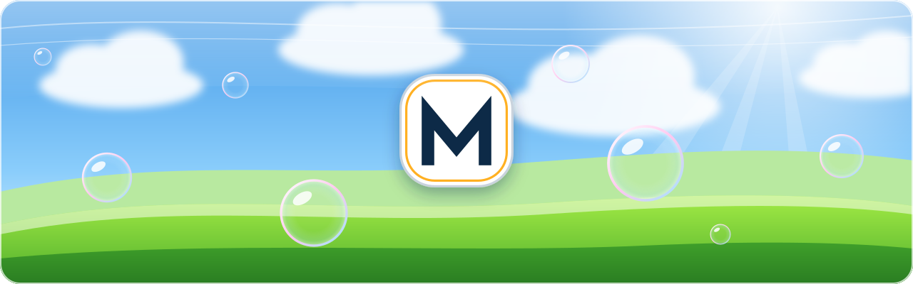
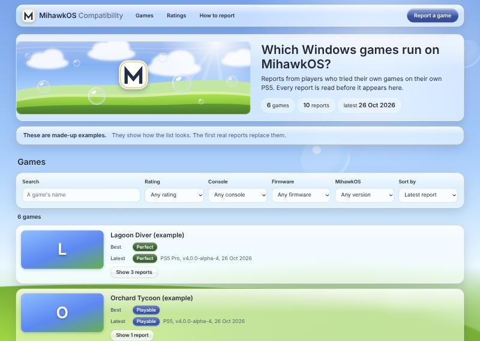
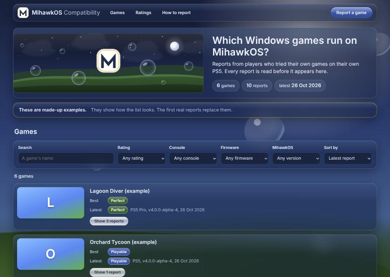

<div align="center">

# MihawkOS Compatibility

**Which Windows games run on MihawkOS, from the players who tried them.**

[The list](https://mihawk-99.github.io/MihawkOS-Compatibility/) · [Report a game](#report-a-game) · [Ratings](#what-the-ratings-mean) · [Moderation](#how-reports-are-moderated) · [MihawkOS](https://github.com/mihawk-99/PS5_MihawkOS)

</div>

<p align="center">
  <picture><source media="(prefers-color-scheme: dark)" srcset="src/assets/banner-night.svg"></picture>
</p>

## MihawkOS is a passion project, not a piracy project.

This list is about games you own, played on the console you own.

- **No games, keys, saves, firmware or exploits** are on this page, in this repository or in its reports, and they
  never will be.
- **Requests for, or links to, any of them** are not published.

<p align="center"><picture><source media="(prefers-color-scheme: dark)" srcset="src/assets/divider-night.svg"></picture></p>

## What it is

[MihawkOS](https://github.com/mihawk-99/PS5_MihawkOS) runs Windows games on a PS5 that already runs homebrew. This
page collects what players found: which game, on which console and firmware, on which MihawkOS version, and how well
it ran.

Each game has one row, with its **best** rating, its **latest** rating and how many reports it has. Open a row to read
every report. You can search by name, filter by rating, console, firmware and MihawkOS version, and sort the list.
Pictures are the games' Steam headers, by the report's Steam AppID or else by the game's exact name on Steam. A report
also shows the launcher the game was started from, with its logo.

It opens at night; the Day/Night slider in the header switches, and your browser remembers the choice on your
device. It is a plain web page on GitHub Pages: no account, no cookies, no trackers, no analytics.

| Day | Night |
| --- | --- |
|  |  |

The screenshots show made-up examples.

## Report a game

1. Play a game you own on MihawkOS.
2. Press **Report a game** on [the list](https://mihawk-99.github.io/MihawkOS-Compatibility/) and fill in the short form.
   It needs no account and no e-mail.
3. Your report is read, then it appears on the list, usually within a day.

The form asks for:

| Field | |
| --- | --- |
| Game | its name, as on its store page |
| Steam AppID | optional: the number in its Steam store link; without it, the picture is found by the game's name |
| Launcher | optional: Steam, Epic Games Store, GOG Galaxy, EA app, Ubisoft Connect, Battle.net, Rockstar Games Launcher, itch.io, other, or none |
| MihawkOS version | from a list |
| Console | PS5, PS5 Slim, PS5 Digital Edition or PS5 Pro |
| Firmware | like 10.01 or 13.40 |
| Rating | one of the five below |
| FPS | optional: about how many frames per second |
| Settings | optional: what you changed, like 120 Hz, Game Mode or the controller type |
| Notes | optional: what worked and what did not |
| Nickname | optional: shown with your report; leave it empty to stay anonymous |

**Write only about the game.** Links, e-mail addresses and HTML are removed before anything is published. Do not
write personal details.

## What the ratings mean

| Rating | Means |
| --- | --- |
| **Perfect** | Plays from start to end as on a PC, with nothing to change. |
| **Playable** | Plays to the end. Small problems, or a setting to change, but nothing that stops you. |
| **Runs with issues** | You can play, but something gets in the way: slowdowns, missing sound or video, crashes now and then. |
| **Boots only** | Starts and reaches its menu or first scene, but you cannot really play it. |
| **Broken** | Does not start, or stops before you see anything. |

A game's **best** rating says what is possible. Its **latest** says how it runs on recent versions. Filters work on
reports first: filter by PS5 Pro and firmware 10.01, and a game's best and latest are those of the reports from that
console and firmware.

## How reports are moderated

Nothing anyone writes goes straight to the page.

1. The form writes each report into a private Google Sheet.
2. The maintainer reads it and ticks **Approved**, or leaves it out.
3. Only ticked rows are published, from a separate tab, as a CSV file.
4. Once a day, a GitHub Action reads that file. It keeps the approved rows, checks every field against the known
   values, removes HTML, links and e-mail addresses, cuts long text, and writes `data/reports.json`. Then it rebuilds
   the page.

A report that breaks the rules above is not published. A published report can be taken down by unticking it.

**What is published:** the fields above, and the day of the report (not the time). **What is not collected:** e-mail
addresses, accounts or names, unless you write a nickname. **One request leaves this site:** your browser fetches
game pictures from Steam's public image server (`shared.steamstatic.com`), without a referrer.

## How it works

| Part | File |
| --- | --- |
| The form's exact fields, the sheet, the checks and the WebUI's future "Report this game" link | [`docs/FORM.md`](docs/FORM.md) |
| The maintainer's setup, click by click | [`OWNER_SETUP.md`](OWNER_SETUP.md) |
| Fetch, validate and write the reports | [`scripts/build-reports.mjs`](scripts/build-reports.mjs), tested by [`scripts/build-reports.test.mjs`](scripts/build-reports.test.mjs) against [sample](scripts/fixtures/sample.csv) and [hostile](scripts/fixtures/hostile.csv) sheets |
| The daily run | [`.github/workflows/publish.yml`](.github/workflows/publish.yml): actions pinned to commits, least privilege, no installed code in the job that can push |
| The page | [`src/App.jsx`](src/App.jsx), [`src/app.css`](src/app.css), [`src/fields.js`](src/fields.js) (the ratings and consoles, shared with the script) |
| The data | [`data/reports.json`](data/reports.json): the made-up examples until the first real run; [`data/appids.json`](data/appids.json): AppIDs found by name |
| Launcher logos | [`src/launchers.js`](src/launchers.js), from Simple Icons |

```bash
npm ci
npm test                                                   # the validator, with hostile input
npm run dev                                                # the page at http://localhost:5173
npm run reports -- --csv scripts/fixtures/sample.csv       # rebuild data/reports.json from a CSV file (--offline: no Steam lookups)
npm run build                                              # the static site in dist/
```

Node 22.12 or later.

## Licences

The page's code is **GPL-3.0-or-later** ([LICENSE](LICENSE)). Its look comes from MihawkOS's WebUI, by the same
author. The banner, divider and Mihawk mark are MihawkOS's own art, **LGPL-2.1-or-later**. Inter is **OFL-1.1**. React
is **MIT**. The launcher logos come from Simple Icons (**CC0-1.0**) and remain their owners' trademarks. [NOTICE.md](NOTICE.md) lists every file's origin and revision. Game pictures are not part of this
repository: they belong to the games' publishers, and your browser loads them from Steam.
